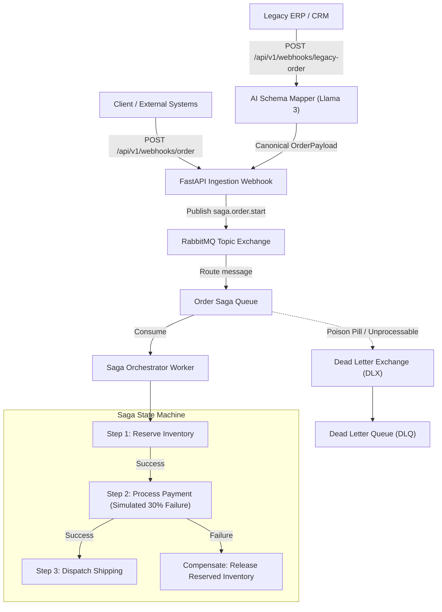

# Enterprise Integration Orchestrator

[](https://www.python.org/downloads/)
[](https://fastapi.tiangolo.com)
[](https://www.rabbitmq.com)
[](https://ai.meta.com/llama/)
[](https://prometheus.io)

An event-driven enterprise integration microservice orchestrator implementing the **Saga Pattern** for distributed transactions with automatic compensating rollbacks. Features dynamic AI schema mapping using **Meta Llama 3**, robust fault tolerance with **RabbitMQ Dead Letter Queues (DLQ)**, and full observability with **Prometheus**.

---

## Architecture Overview



---

## Core Features

1. **Saga State Machine (Forward-Recovery & Backward-Compensation)**
   - **Step 1: Reserve Inventory** - Asynchronously reserves catalog items and generates reservation tokens.
   - **Step 2: Process Payment** - Simulates financial gateway processing with a configurable 30% failure rate.
   - **Step 3: Dispatch Shipping** - Books logistics carrier dispatch with package tracking numbers.
   - **Automatic Compensation**: Upon payment failure, the orchestrator initiates backward compensation, releasing all reserved inventory units to prevent phantom locks.

2. **AI-Powered Schema Mapper (Meta Llama 3)**
   - Ingests arbitrary, heterogeneous, or legacy JSON payloads from older ERPs or CRMs.
   - Leverages Meta Llama 3 via OpenAI-compatible endpoints (`Groq`, `vLLM`, `Together`) to transform inputs into strict Pydantic `OrderPayload` models.
   - Includes a deterministic heuristic fallback for zero-downtime offline execution.

3. **Fault Tolerance & Dead Lettering**
   - Configured with `x-dead-letter-exchange` and `x-dead-letter-routing-key`.
   - Poison-pill or malformed messages are safely routed to a dedicated Dead Letter Queue (`saga.dlx.queue`) without blocking the primary ingestion queue.

4. **Observability & Prometheus Metrics**
   - Direct Prometheus endpoint exposed at `GET /metrics`.
   - Tracks in-progress requests, HTTP latency, saga execution rates, step durations, and compensation events.

---

## Tech Stack

- **Backend**: Python 3.12+, FastAPI, Uvicorn
- **Asynchronous Messaging**: RabbitMQ, `aio-pika`
- **AI Engine**: Meta Llama 3 (`llama3-70b-8192` via async `httpx`)
- **Data Validation**: Pydantic v2
- **Metrics**: `prometheus-fastapi-instrumentator`, `prometheus_client`
- **Containerization**: Docker, Docker Compose

---

## Project Structure

```text
enterprise-integration-orchestrator/
├── app/
│   ├── api/
│   │   └── webhooks.py         # Webhook endpoints for standard and legacy orders
│   ├── core/
│   │   ├── config.py           # Environment and broker settings
│   │   ├── metrics.py          # Prometheus counters and histograms
│   │   └── rabbitmq.py         # Async RabbitMQ client, topologies, and DLQ setup
│   ├── models/
│   │   ├── message.py          # Enterprise integration message envelops
│   │   └── schemas.py          # Pydantic schemas (Order, Saga, Inventory, Payment)
│   ├── services/
│   │   ├── ai_mapper.py        # Meta Llama 3 dynamic schema transformation engine
│   │   └── orchestrator.py     # 3-step Saga State Machine & compensation worker
│   └── main.py                 # FastAPI lifecycle, Prometheus metrics, and routing
├── Dockerfile                  # Production container definition
├── docker-compose.yml          # Multi-container orchestration (App + RabbitMQ)
├── requirements.txt            # Python dependencies
└── .env.example                # Sample environment configuration
```

---

## Quickstart Guide

### 1. Running with Docker Compose (Recommended)

Start the entire stack (FastAPI app + RabbitMQ broker with Management UI):

```bash
docker compose up --build
```

- **FastAPI API & Docs**: [http://localhost:8000/docs](http://localhost:8000/docs)
- **Prometheus Metrics**: [http://localhost:8000/metrics](http://localhost:8000/metrics)
- **Health Check**: [http://localhost:8000/health](http://localhost:8000/health)
- **RabbitMQ Management Dashboard**: [http://localhost:15672](http://localhost:15672) (User: `guest`, Pass: `guest`)

---

### 2. Local Development Setup

1. **Clone and create a virtual environment:**
   ```bash
   git clone https://github.com/ChaninduImanjith/enterprise-integration-orchestrator.git
   cd enterprise-integration-orchestrator
   python -m venv venv
   source venv/bin/activate
   pip install -r requirements.txt
   ```

2. **Configure environment variables:**
   ```bash
   cp .env.example .env
   ```

3. **Start RabbitMQ:**
   ```bash
   docker run -d --name rabbitmq -p 5672:5672 -p 15672:15672 rabbitmq:3-management
   ```

4. **Launch the Orchestrator:**
   ```bash
   uvicorn app.main:app --host 0.0.0.0 --port 8000 --reload
   ```

---

## API Endpoints

### 1. Ingest Standard Enterprise Order
**`POST /api/v1/webhooks/order`**

```json
{
  "customer_id": "CUST-9874",
  "customer_email": "procurement@enterprise.com",
  "currency": "USD",
  "total_amount": 450.00,
  "items": [
    {
      "item_id": "SKU-99",
      "name": "Industrial Sensor Mod v2",
      "quantity": 3,
      "unit_price": 150.00
    }
  ]
}
```

### 2. Ingest Legacy / Unstructured Payload (AI-Mapped)
**`POST /api/v1/webhooks/legacy-order`**

```json
{
  "account_number": "LEGACY-ACC-01",
  "contact_email": "purchasing@client.org",
  "curr": "USD",
  "order_total": 300.0,
  "line_items": [
    {
      "sku": "VALVE-44",
      "description": "High Pressure Pneumatic Valve",
      "qty": 2,
      "cost": 150.0
    }
  ]
}
```

### 3. Observability & Metrics
**`GET /metrics`**

Exposes Prometheus metrics including:
- `saga_executions_total{status="completed|compensated|failed"}`
- `saga_compensations_total{step_name="inventory|payment"}`
- `saga_step_duration_seconds_bucket`
- `ai_schema_mappings_total{method="llama3_api|heuristic_fallback",status="success|fallback"}`

